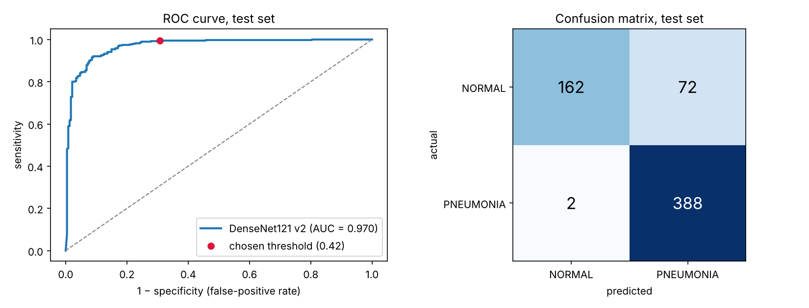
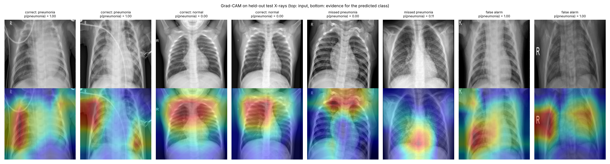

# Pneumonia Detection from Paediatric Chest X-rays

A DenseNet121 classifier that detects pneumonia on paediatric chest X-rays, with patient-level validation,
honest held-out test metrics, and Grad-CAM explanations.

**Held-out test set (624 X-rays, never used for training or tuning):**

| Metric | Result | 95% CI |
| --- | --- | --- |
| ROC-AUC | **0.970** | 0.955 – 0.982 |
| Sensitivity (pneumonia detected) | **0.995**: 388 of 390 | 0.987 – 1.000 |
| Specificity (normal correctly cleared) | **0.692**: 162 of 234 | 0.636 – 0.751 |
| Accuracy | **0.881** | 0.857 – 0.905 |
| F1 | 0.913 | 0.893 – 0.931 |

Decision threshold 0.42, chosen on the validation set only. Confidence intervals come from 2,000 bootstrap
resamples of the test set.



## What changed from v1

The first version (`Pneumonia.ipynb`) was a 6-layer CNN trained from scratch. Its README said it "performed
well on both training and test", but the notebook shows **92.6% training accuracy and 76.8% test accuracy**, with
validation loss rising from 0.61 to 1.56. That's overfitting. v2 (`Pneumonia_v2.ipynb`) fixes the causes:

| v1 | v2 |
| --- | --- |
| 16-image validation set, so validation scores were mostly noise | 748-image validation set, **split by patient** so no child appears in both training and validation |
| Class imbalance (1 normal : 2.9 pneumonia) ignored | Balanced class weights |
| Small CNN from scratch | DenseNet121 pretrained on ImageNet (the CheXNet architecture), fine-tuned in two stages |
| Vertical and horizontal flips | Small rotations, shifts, zoom and contrast changes only; no flips, since anatomy isn't symmetric |
| Accuracy only, threshold fixed at 0.5 | ROC-AUC, sensitivity, specificity, F1, bootstrap CIs; threshold chosen on validation |
| No explanation | Grad-CAM heatmaps plus a test-set-wide check of where the model looks |
| No leakage check | Checked for exact and near-duplicate images across train and test: none found |

**Result:** test accuracy rose from 76.8% to 88.1%, with ROC-AUC 0.970. The model misses only 2 of 390 pneumonia cases.

## Grad-CAM: where the model looks



For correct predictions, the heatmaps sit on the lung fields. Across **all 624 test images**, about 42% of
heatmap weight falls in the outer border of the image. That's below the 51% expected if attention were spread
evenly, and false alarms (41%) look the same as correct calls. So most errors are *not* caused by text markers
or edges.

One false alarm is clearly driven by the "R" side marker, though, and about 18% of normal-class heatmaps are
mostly on the border. Masking markers and cropping to the lungs is the next experiment.

## Limitations (read these before quoting the numbers)

- **Specificity falls between validation and test.** At the same threshold, specificity is 0.98 on the
  patient-held-out validation set but 0.69 on the official test folder. Sensitivity hardly changes. The normal
  X-rays in the test folder look different from those in training, so this is a dataset-shift problem, not
  overfitting. I did not tune the threshold on the test set, because that would inflate the results. The fix in
  practice is to recalibrate on a small labelled sample from the target hospital.
- **Single centre, children only.** All images come from one hospital in Guangzhou (ages 1–5). The model hasn't
  been tested on adults or on other hospitals' equipment.
- **Labels** come from the original study's clinical diagnoses, not a per-image radiologist consensus.
- **Not a medical device.** This is a research and learning project.

## Run it

**Google Colab (choose a GPU runtime; it trains much faster than the CPU run reported here):**
```python
!pip install kagglehub
import kagglehub, os
path = kagglehub.dataset_download("paultimothymooney/chest-xray-pneumonia")
os.environ["DATA_DIR"] = os.path.join(path, "chest_xray")
# then run all cells in Pneumonia_v2.ipynb
```

**Local:**
```bash
pip install -r requirements.txt
DATA_DIR=/path/to/chest_xray jupyter notebook Pneumonia_v2.ipynb
python app.py          # Gradio demo: upload an X-ray, get a decision and a Grad-CAM heatmap
```

The trained model (`outputs/pneumonia_densenet121.keras`, 47 MB) is included, so `app.py` works without retraining.
The results above come from a CPU run (2 cores, about 58 minutes of training). The executed notebook keeps every
output.

## Files

| File | Contents |
| --- | --- |
| `Pneumonia_v2.ipynb` | Full pipeline: data checks, patient-level split, training, evaluation, Grad-CAM (executed, with outputs) |
| `Pneumonia.ipynb` | Original v1 notebook, kept for comparison |
| `app.py` | Gradio demo with Grad-CAM overlay |
| `outputs/metrics.json` | All test metrics, CIs, threshold, split sizes |
| `outputs/test_predictions.csv` | Per-image test probabilities |
| `outputs/history.csv`, `training_curves.png` | Training history |
| `outputs/gradcam_border_attention.csv` | Test-set-wide Grad-CAM border-attention analysis |

## Data and references

- Kermany D. et al. (2018). Identifying medical diagnoses and treatable diseases by image-based deep learning.
  *Cell* 172(5). Dataset: [Chest X-Ray Images (Pneumonia), Kaggle](https://www.kaggle.com/datasets/paultimothymooney/chest-xray-pneumonia).
- Rajpurkar P. et al. (2017). CheXNet: Radiologist-level pneumonia detection on chest X-rays with deep learning. arXiv:1711.05225.
- Selvaraju R. R. et al. (2017). Grad-CAM: Visual explanations from deep networks via gradient-based localization. *ICCV*.

**Author:** Mohammed Afeez Olamilekan · [GitHub](https://github.com/NKASG)
